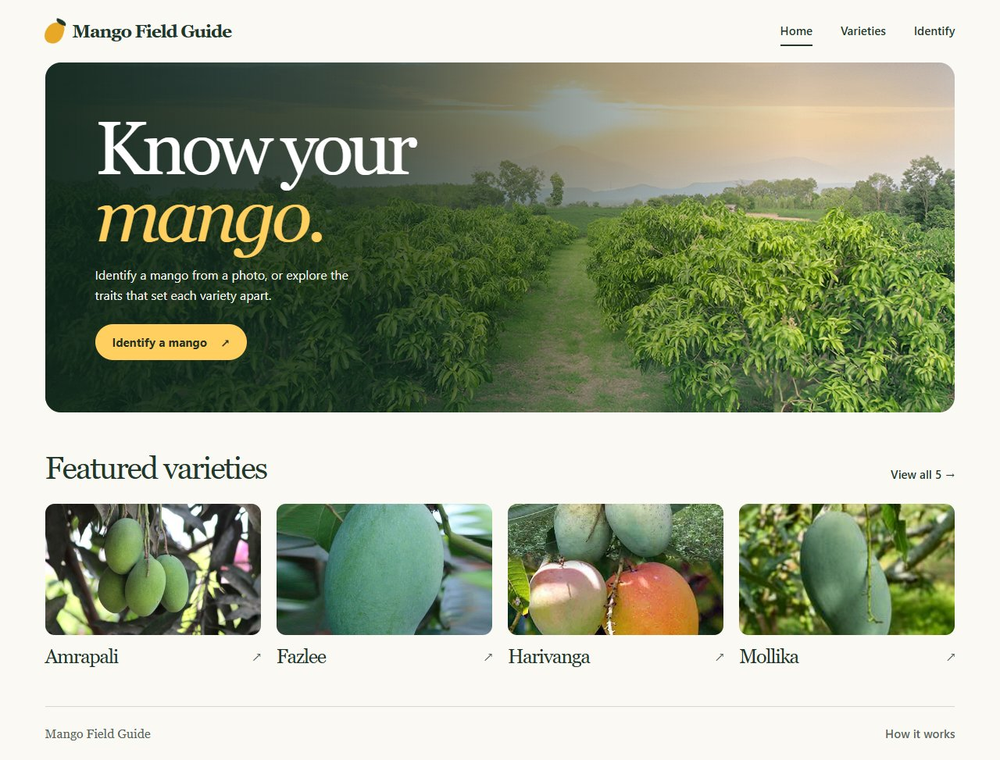

# Mango Field Guide

Photograph a mango, get a suggested variety, and compare the fruit with a reference profile. The classifier recognizes five varieties: Amrapali, Fazlee, Harivanga, Mollika, and Nilambori. Each profile describes the fruit’s appearance, origin, harvest season, and flavor.



## From training to inference

The model uses an ImageNet-pretrained MobileNetV2 backbone and 224 × 224 RGB inputs. Training starts with the backbone frozen, then fine-tunes its upper layers. The notebook records **96.86% test accuracy on 700 images**, with 140 examples per variety. Nilambori had the lowest recall at 0.91. These figures describe the notebook’s test split. Performance on independently collected field photos remains unmeasured. [Training notebook and evaluation](notebooks/mango_classifier.ipynb)

The local Flask app runs the saved Keras model. For the Render Free service, the same model is exported to an **8.9 MB float32 LiteRT file** so the inference worker can run without loading TensorFlow. On the five bundled guide photos, both runtimes returned the same variety and the same confidence rounded to two decimal places. [Model export](deploy/export_model.py) · [Inference service](deploy/service.py)

## Try it locally

Use Python 3.12 in a virtual environment. The repository includes the trained model, so you can run the guide without downloading the training dataset or configuring a database.

```bash
git clone https://github.com/estoceorlan-dev/Mango-Classifier.git
cd Mango-Classifier
python -m venv .venv
```

Activate it with `.\.venv\Scripts\Activate.ps1` in PowerShell or `source .venv/bin/activate` on macOS or Linux. Then run:

```bash
python -m pip install -r requirements.txt
python app.py
```

Open [the local classifier](http://127.0.0.1:5000/classify). Try the [Fazlee sample](app/static/images/Fazlee.webp), or take a photo with your camera. The local Flask app saves uploaded images in `app/static/uploads/`.

## Deployment architecture

| Component | Responsibility | Configuration |
| --- | --- | --- |
| Vercel | Serves nine static pages built from the Flask templates. The browser sends the selected photo directly to Render. | [Frontend build](deploy/frontend.py) · [Vercel settings](vercel.json) |
| Render Free | Runs one Gunicorn worker. `POST /predict` validates the image, runs LiteRT inference, and returns the variety, confidence, and guide slug. | [Service blueprint](render.yaml) |
| Neon Postgres | Stores a row ID, timestamp, predicted variety, and confidence for each successful prediction. The photo stays out of the database. | [Schema initialization](deploy/database.py) |

### Deploy your own copy

1. **Neon** — Select a project and branch. Copy the pooled connection string, including its TLS parameters, for a role that can create the predictions table.
2. **Render** — Create a Blueprint from the repository root. Set the secret `DATABASE_URL` to the Neon connection string. Once the service is running, open its `/health` endpoint and check for `{"status":"ok"}`.
3. **Vercel** — Import the repository using the **Other** framework preset and the repository root. Set `RENDER_API_ORIGIN` to your Render service’s public HTTPS origin and deploy. Changing this value requires a frontend rebuild.
4. **Verify** — Submit a photo from the Vercel site, follow the variety link, and run the query below in Neon to confirm the write. Allow time for the first prediction after the free service wakes. [Render Free service behavior](https://render.com/docs/free)

```sql
SELECT created_at, variety, confidence
FROM mango_predictions
ORDER BY id DESC
LIMIT 5;
```

To ship new weights, replace the [Keras model](models/mango_classifier.keras), run `python -m deploy.export_model` in the TensorFlow environment, and commit the regenerated [LiteRT model](models/mango_classifier.tflite) alongside its [class index](notebooks/class_indices.json).
